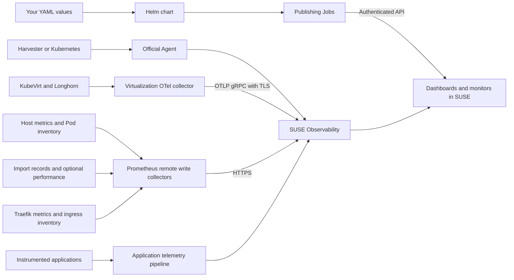

# Dashboard configuration, step by step

This guide explains what we configured, why it is there and how to repeat it. Use the [README](../README.md) for the installation commands. Keep this page beside it when you want to understand a setting or change the setup.

The examples use chart **1.7.0** and the lab's **SUSE Observability 2.10.2** baseline. They are not a compatibility promise for every server, Agent or Harvester version. Documentation was reviewed on **2026-10-29**. The detailed installation and UI results are recorded in [Lab validation](lab-validation.md).

> [!WARNING]
> Community project for labs and learning. Not recommended for production and not an officially supported SUSE integration. Validate the metrics, resource usage, permissions and alert policy in your own environment.

**Find a topic:** [Architecture](#1-understand-what-is-being-installed) · [Lab setup](#how-the-current-lab-is-organized) · [Credentials](#3-understand-the-three-credentials) · [Virtualization prerequisites](#5-prepare-the-virtualization-metric-path) · [Install](#6-fill-in-the-module-file-and-install) · [Check](#7-check-the-complete-path) · [Additional modules](#8-add-another-module-or-another-cluster) · [Dashboard creation](#9-understand-how-dashboards-are-created) · [Remove](#11-update-remove-and-reinstall) · [Parameter reference](#12-chart-parameters-common-settings)

## 1. Understand what is being installed

There are three separate jobs here:

1. **The official Agent connects the cluster to SUSE.** It supplies the Kubernetes inventory, topology and its standard signals.
2. **Collectors send the extra measurements.** A collector reads an API or metrics endpoint and forwards the results. It does not start VMs, repair storage or import VMware machines.
3. **The publisher creates the dashboards and monitors.** It is a short-lived Kubernetes Job. The dashboard itself is stored in SUSE, not inside the collector Pod.



**Why separate modules?** A cluster with VMs does not necessarily have Traefik, VM Import Controller or instrumented applications. Each module owns its own content. Install only what you have measurements for.

| Module | Additional collection | Content |
|---|---|---|
| Virtualization | KubeVirt, Longhorn, Linux host metrics and Pod resource inventory | 4 dashboards, 7 monitors |
| Imports | Retained VM Import Controller records; optional controller/image-service CPU, memory and network | 1 dashboard, 3 monitors |
| Kubernetes | Linux host metrics and Pod resource inventory; optional etcd | 2 dashboards, 21 monitors |
| Traefik | Traefik Prometheus endpoint and Kubernetes ingress inventory | 1 dashboard, 6 monitors |
| Applications | None; uses an existing application telemetry pipeline | 1 dashboard, 2 monitors |

`vmagent` in a collector is a Prometheus-compatible forwarding program. Its name does **not** mean it runs inside a virtual machine. An OTel Collector is another forwarding program, using OpenTelemetry pipelines. Neither is the SUSE Observability server.

### Connections used by the installation

| From → to | Protocol / usual port | Purpose |
|---|---|---|
| Publisher → SUSE browser/API address | HTTPS / 443 | Create, verify and delete content |
| Host, Pod, Imports and Traefik forwarders → SUSE | HTTPS / 443 | Prometheus remote write |
| Virtualization/application OTel collector → server OTLP address | TLS gRPC / 443 externally, 4317 behind ingress | Send telemetry |
| Virtualization collector → KubeVirt endpoints | HTTPS / discovered metrics port, normally 8443 | Read VM metrics with KubeVirt CA verification |
| Virtualization collector → Longhorn managers | HTTP / 9500 internally | Read storage metrics; this port also exposes the Longhorn API |
| Optional Imports performance collector → nodes | HTTPS / 10250 | Read kubelet `/metrics/cadvisor` with a scoped ServiceAccount |
| Traefik collector → existing Traefik metrics endpoints | HTTP / 9100 by default | Read ingress traffic metrics |
| Discovery/inventory collectors → Kubernetes API | HTTPS / cluster API Service | Discover endpoints and read permitted resource metadata |

Also allow the required cluster DNS and image/CLI downloads. This is a description of the configured paths, not a request to open every port globally. Confirm actual Service ports and existing ingress/egress policies in each cluster.

## 2. Write down the environment before starting

Use a private note like this. Replace the examples once, then use the same names throughout your commands.

| Item | Example | Why you need it |
|---|---|---|
| Server kubeconfig / context | `/path/to/observability.yaml` / `observability` | Only for configuring the SUSE server and its ingress |
| Monitored cluster kubeconfig / context | `/path/to/cluster.yaml` / `my-cluster` | Installs the Agent and collectors on the correct cluster |
| Agent / collector namespace | `suse-observability` | Collectors reference Secrets in this namespace |
| Integration name | `my-cluster` | Joins collected measurements with the cluster in SUSE; may differ from the context |
| Browser/API URL | `https://observability.example.com` | Publisher destination and base for Prometheus remote write |
| Agent receiver | `https://observability.example.com/receiver/stsAgent` | Destination for the official Agent |
| OTLP gRPC address | `otlp-observability.example.com:443` | Destination for the Virtualization or separate application OTel collector |
| Dashboard chart version | `1.7.0` | Reproducible module installation |
| Server and Agent chart versions | Record the installed versions | Separate release cycles; do not substitute `1.7.0` here |

**Run on your computer:**

```sh
kubectl config get-contexts --kubeconfig /path/to/cluster.yaml
kubectl get nodes --kubeconfig /path/to/cluster.yaml --context my-cluster
helm list --all-namespaces --kubeconfig /path/to/cluster.yaml --kube-context my-cluster
```

**Check before continuing:** you recognize the nodes and know who owns existing releases. Fleet, a Harvester add-on and manual Helm must not manage the same release simultaneously. Use the owner's configuration for changes.

### How the current lab is organized

The lab uses the optional **central publisher** arrangement. All five content releases are on the Observability cluster; collectors run on the source clusters. A new environment can start more simply with `mode: all` on its first monitored cluster.

Read-only release inspection on 2026-10-28 confirmed server chart `2.10.2`, all five central content charts at `1.6.0`, Harvester Virtualization telemetry at `1.3.0`, Imports telemetry at `1.4.2` and the Harvester Agent at `1.2.14`. Content and collectors can have different versions because the latest updates changed dashboard definitions. That documentation update did not upgrade those releases. On 2026-10-29, the five central content releases were upgraded to 1.7.0 for the dashboard/filter review; the source collectors and platform releases were preserved.

| Cluster | Namespace | Module releases | Mode / chart version |
|---|---|---|---|
| Harvester | `suse-observability` | `obs-virtualization` | `telemetry` / 1.3.0 |
| Harvester | `suse-observability` | `obs-imports` | `telemetry` / 1.4.2 |
| Rancher lab | `suse-observability` | `obs-kubernetes`, `obs-traefik` | `telemetry` / 1.3.0 |
| Observability | `suse-observability-agent` | `obs-kubernetes`, `obs-traefik` | `telemetry` / 1.3.0 |
| Observability | `suse-observability` | `obs-virtualization`, `obs-imports`, `obs-kubernetes`, `obs-traefik`, `obs-applications` | `content` / 1.7.0 |

The same release name can exist in different clusters/namespaces. Always include the destination flags when updating or removing it. The two Observability namespaces are intentional: one contains its Agent/collectors and the other contains the server/publishers. The integration names are `harvester`, `rancher-kaio` and `observability-cluster`; the last differs from its kubeconfig context `observability`.

Lab choices worth understanding:

- The existing server, official Agents, applications, VMs and volumes were preserved.
- KubeVirt collection validates TLS and refreshes its public CA from the cluster.
- Longhorn collection needed an additional allowance for TCP/9500 from the named Virtualization collector. That port also serves the Longhorn API; it was not exposed publicly.
- Imports performance collection was enabled with read-only kubelet metric access. It measures shared infrastructure, not the speed of each VM transfer.
- Host-collector releases in the lab explicitly enable `telemetry.etcd.enabled`; new installations default to false. Only repeat this after checking the local etcd metrics endpoint. Rancher lab Traefik also has the reviewed metrics network allowance enabled.
- Dashboards and monitor definitions are published automatically. Notification delivery is a separate configuration and was not tested.
- Coriolis was left out. This project does not claim Coriolis API or transfer validation.

For the full history and the exact scope of each test, read [Lab validation](lab-validation.md). Do not treat a previous healthy snapshot as today's measurement.

## 3. Understand the three credentials

| Credential | What it allows | Where it is used |
|---|---|---|
| Ingestion token | Send measurements to SUSE | Official Agent and metric collectors |
| Publishing Service Token | Manage the project's dashboards and monitors | Publishing Jobs |
| Registry credential | Pull the Virtualization collector image | Kubernetes image pull Secret |

They are not interchangeable. A Kubernetes ServiceAccount controls access **inside Kubernetes**; a SUSE Service Token controls access **to SUSE**.

**Prepare the ingestion token:** create the cluster integration in the Kubernetes StackPack and follow the instructions from your SUSE version. The [README Agent step](../README.md#connect-the-cluster-to-suse) installs it through Helm and checks the resulting Secret. The default Secret/key used by these charts is `suse-observability-agent-secrets` / `STS_API_KEY`.

**Prepare the publishing token:** the SUSE administrator must issue a service identity with dashboard and monitor management permissions. The [official Service Token guide](https://documentation.suse.com/cloudnative/suse-observability/latest/en/use/security/k8s-service-tokens.html) describes issuance and roles. This guide does not pretend that `kubectl create secret` grants those permissions. Ask for the token before beginning the Helm installation. Keep the same publishing identity for updates and removal.

Save it in a private text file containing only the token, without a trailing newline. Then run:

```sh
kubectl create secret generic suse-observability-publisher-token \
  --from-file=serviceToken=/private/publisher-token.txt \
  --kubeconfig /path/to/cluster.yaml --context my-cluster --namespace suse-observability
```

**What each part means:** `generic` creates an ordinary Secret; `serviceToken` is the key the Job reads; `/private/publisher-token.txt` is a local file, not a path inside a Pod. The namespace must already exist. Do not run this again if the correct Secret already exists.

Store credentials in your approved secret store. Keep private files and Helm value exports out of Git. Helm's Agent release values can contain the ingestion token even when `--set-file` kept it out of the command line.

## 4. Prepare SUSE Observability and the Agent

**Why:** a dashboard needs both measurements and resource identities. A monitor can have a valid query but no component to attach to if the Agent's topology is missing.

1. Prepare the server using the [README server prerequisite](../README.md#if-suse-observability-is-not-installed-yet). That section links sizing, installation, compatibility and ingress documentation.
2. On the monitored cluster, install one official Agent using the [README Agent procedure](../README.md#connect-the-cluster-to-suse). On Harvester, use the version-specific Agent/add-on documentation linked there.
3. Wait for nodes and Pods to appear in SUSE. Check the Agent's cluster name and Secret keys. Copy the integration name exactly into `clusterName`.
4. Create the publishing Secret once in the namespace that will publish content.

**Check before continuing:** login works, the cluster is visible, the correct Secret exists and you know the Agent namespace. Newer official instructions may use `suse-observability-agent`; this lab uses `suse-observability`. Replace the example namespace consistently rather than moving a working Agent just for these charts.

**Only Applications?** The content chart needs only its publisher credentials. Its measurements still need a working application telemetry pipeline. Follow [application telemetry setup](application-telemetry.md), which also explains the Agent version boundary.

## 5. Prepare the Virtualization metric path

**Why:** the official Kubernetes integration and these four dashboards need different additional signals. This module collects KubeVirt and Longhorn metrics, plus host and Pod inventory data.

### 5.1 Prepare the server's OTLP endpoint

Follow [OTLP setup](otlp.md) on the **server cluster**. Use an existing gRPC endpoint if one already works. You need a DNS name, a valid certificate and ingress routing to the server's gRPC collector Service. The public example is port 443; the backend Service uses 4317.

`observability.url` takes an HTTPS URL. `observability.otlpEndpoint` takes `host:port`, without `https://`. Using the browser URL as the OTLP endpoint does not automatically enable gRPC routing.

### 5.2 Prepare access to the collector image

Follow [Application Collection authentication](https://docs.apps.rancher.io/get-started/authentication). An account/service account needs access to the selected image. Save the Docker-compatible registry configuration supplied by your administrator as `/private/config.json`, then use the pull Secret command in [README option A](../README.md#install-virtualization).

The file must contain credentials under `auths` for `dp.apps.rancher.io`. A configuration that only references a laptop credential helper is not sufficient inside Kubernetes. The Secret must be in the collector namespace and use type `kubernetes.io/dockerconfigjson`.

**Check:** the Secret is present; after installation, the collector must pull its image successfully. Secret existence alone does not prove registry access.

### 5.3 Check KubeVirt discovery and certificate trust

```sh
kubectl get service kubevirt-prometheus-metrics --namespace harvester-system \
  --kubeconfig /path/to/cluster.yaml --context my-cluster
kubectl get configmap kubevirt-ca --namespace harvester-system \
  --kubeconfig /path/to/cluster.yaml --context my-cluster
kubectl get endpointslices --selector kubernetes.io/service-name=kubevirt-prometheus-metrics \
  --namespace harvester-system --kubeconfig /path/to/cluster.yaml --context my-cluster
```

The collector discovers ready endpoints and validates their TLS names. Its CA helper reads the named public ConfigMap and refreshes a file shared with the collector. It does not need the KubeVirt private key. Leave `virtualization.kubevirt.ca.autoSync: true` unless you deliberately manage the CA copy yourself.

**Check:** the Service, CA and endpoints exist. An empty endpoint list needs investigation before installation. A VM filesystem panel may still be empty if the required guest-agent data is unavailable; installing a collector cannot create that guest measurement.

### 5.4 Check Longhorn access

```sh
kubectl get service longhorn-backend --namespace longhorn-system \
  --kubeconfig /path/to/cluster.yaml --context my-cluster
kubectl get networkpolicy --namespace longhorn-system \
  --kubeconfig /path/to/cluster.yaml --context my-cluster
```

If the existing isolation blocks the collector, have its owner review the policies. Only after confirming that isolation already exists, add this to `virtualization.yaml`:

```yaml
virtualization:
  longhorn:
    allowMetricsNetworkPolicy: true
    existingIsolationConfirmed: true
```

This creates an **additional** ingress allow rule selecting the collector namespace **and** its Pod labels, for Longhorn manager TCP/9500. Kubernetes policies are additive: this rule does not revoke access granted by other policies. Source egress policies and the network plugin can still block the connection. The flag records your review; it does not inspect or prove the existing isolation.

Do not create the first ingress isolation policy blindly: it could block platform traffic. If storage collection is not required, set `virtualization.longhorn.enabled: false` and accept that its panels/monitors will have no samples.

## 6. Fill in the module file and install

For the first Virtualization installation, save `virtualization.yaml`:

```yaml
clusterName: my-cluster
observability:
  url: https://observability.example.com
  otlpEndpoint: otlp-observability.example.com:443
```

**Why only three fields?** The chart already supplies collector images, intervals, TLS checks, resource settings, dashboards and monitors. Add Secret, CA or network overrides only when your environment differs. Merge additions into the existing YAML block; do not create two `virtualization:` or `observability:` keys.

```sh
helm repo add obs-dashboards https://raw.githubusercontent.com/kaioneuhauss/suse-observability-dashboards/main/helm
helm repo update obs-dashboards
helm upgrade --install obs-virtualization obs-dashboards/suse-observability-virtualization \
  --version 1.7.0 --values virtualization.yaml \
  --kubeconfig /path/to/cluster.yaml --kube-context my-cluster \
  --namespace suse-observability --wait --timeout 15m
```

| Command part | What it does |
|---|---|
| `upgrade --install` | Installs a missing release or updates the existing one |
| `obs-virtualization` | Your release name; keep it for updates and removal |
| `obs-dashboards/suse-observability-virtualization` | Repository alias and chart name |
| `--version 1.7.0` | Selects the exact published chart package |
| `--values virtualization.yaml` | Merges your settings with the chart defaults |
| `--kubeconfig` / `--kube-context` | Selects the destination cluster explicitly |
| `--namespace` | Places the release beside the required Secrets |
| `--wait --timeout 15m` | Waits for Helm readiness and hooks; it does not validate metric meaning |

**Check:** Helm reports `deployed`. Then follow the next section. Keep the YAML file; you will use it again.

## 7. Check the complete path

**First, Kubernetes:**

```sh
helm status obs-virtualization --kubeconfig /path/to/cluster.yaml \
  --kube-context my-cluster --namespace suse-observability
kubectl rollout status deployment/obs-virtualization --timeout=5m \
  --kubeconfig /path/to/cluster.yaml --context my-cluster --namespace suse-observability
kubectl rollout status deployment/obs-virtualization-pods --timeout=5m \
  --kubeconfig /path/to/cluster.yaml --context my-cluster --namespace suse-observability
kubectl rollout status daemonset/obs-virtualization-node --timeout=5m \
  --kubeconfig /path/to/cluster.yaml --context my-cluster --namespace suse-observability
kubectl logs deployment/obs-virtualization --container collector --tail=50 \
  --kubeconfig /path/to/cluster.yaml --context my-cluster --namespace suse-observability
```

The three workload checks apply to default `mode: all` or `telemetry`. A `content` release has no collectors. Successful publishing Jobs disappear; their absence after a successful Helm command is normal.

**Then, SUSE:** open **Dashboards → All**, choose Virtualization and select the integration name. Allow a few minutes for fresh samples. Check collection health before resource values. Compare running VM names and volume identities with Harvester. Use a current time range for current-state checks.

**Finally, meaning:** compare a known resource with its source at the same time. CPU usage is not CPU waiting time. Guest memory is not host process memory. A backup record is not a successful restore test. The [metric definitions](metric-contracts.md) and [panel guide](panel-guide.md) explain these distinctions.

If a check fails, use [validation and troubleshooting](validation.md). Do not interpret an empty result as zero or healthy, and do not keep reinstalling without checking the error.

## 8. Add another module or another cluster

### Another module on the same cluster

Keep the first release. Reuse the Agent, namespace and credentials. Follow the appropriate [README module option](../README.md#5-install-the-module-you-chose), save another values file and give it another release name.

For example, Imports uses `imports.yaml` and `obs-imports`. It needs the VM Import Controller CRD, but it does not depend on the Virtualization chart. `imports.performance.enabled: true` adds CPU/memory/network collection; default `false` keeps inventory only. The README contains the complete second-module command and expected result.

**Virtualization plus Kubernetes:** both normally install host/Pod collectors. On the same cluster, keep Virtualization as their owner and use `mode: content` for Kubernetes. If Kubernetes was installed first, change it to `content` and upgrade it before adding Virtualization. Do not run two host collector sets on the same ports.

### The same module on another cluster

Use `mode: telemetry` on the additional cluster. Give it its own Agent integration name and local ingestion Secret. It sends data to the existing dashboards, which already have cluster filters. Do not create a second `all` publisher for the same module and SUSE instance.

### A central publisher, as used in the lab

Use `mode: telemetry` on each source cluster and one `mode: content` release per module on the publishing cluster. The central publisher needs only the SUSE URL and publishing Secret. See the complete examples in [Multiple clusters](multiple-clusters.md).

## 9. Understand how dashboards are created

Installing a chart does not launch Grafana. These are native SUSE dashboard definitions.

1. Helm merges the package defaults with your values and validates the result against `values.schema.json`.
2. Templates create the required workloads, configuration and RBAC. Content templates load this module's dashboard JSON and monitor definitions into ConfigMaps.
3. Separate `post-install,post-upgrade` Jobs publish dashboards and monitors using the respective Secret references. They download a pinned official SUSE CLI and verify its checksum before using it.
4. The publisher checks existing identifiers and its module catalog. It creates missing objects and reconciles changed definitions. It checks the persisted result rather than treating a successful command as sufficient.
5. Chart 1.7.0 uses `patch` by default and preserves the IDs of existing dashboards. This was tested with CLI 3.3.6 and SUSE Observability 2.10.2. Explicit `replace` mode deletes/recreates a changed dashboard, so saved links can change. Export personal changes before updating; managed definitions can overwrite them.
6. Helm removes successful hook Jobs. Failed Jobs remain for diagnosis, subject to their TTL. Collectors keep running independently of the completed publisher.

The publisher runs code inside its container. **You do not run local Python or Bash scripts to install, update or remove modules.**

### What makes up one panel?

| Part | Purpose |
|---|---|
| Source metric | The recorded measurement, its unit and labels |
| Query | Selects resources, calculates a rate/ratio and groups values |
| Variables | Cluster, namespace, VM or service filters substituted into the query |
| Visualization | Summary, named list, time series or explanation |
| Unit and decimals | Counts have no fractional digits; percentages and times use appropriate precision |
| Description | Explains what is measured, the time window and the next useful check |
| Detail link | Opens the complete resource query for investigation |

For a new panel, start with a question such as “Which running VMs are waiting for CPU?” Validate the raw series first, keep resource identities in the result, then decide how to display it. Test one resource, several resources, Everything, no match and more than one time range. A correct query that lists no resource names is often not enough to help someone act.

### Create a personal dashboard in SUSE

Use the native editor described in the [official dashboard guide](https://documentation.suse.com/cloudnative/suse-observability/latest/en/use/dashboards/dashboards.html). Create a separately named personal dashboard rather than editing the Helm-managed one. Add and validate a metric in Metrics Explorer, then use that query in a widget. Add a plain-English title, unit and interpretation. Save, reopen and return to the catalog to check that it does not acquire unintended changes.

### Make a reusable change in this project

The source definitions live in `dev/components/suse-observability-content/`. Dashboard curation and chart generation produce the files shipped in `charts/`. `files/catalog.json` selects monitor definitions, including query, severity, threshold, resource association and remediation. `helm/` contains the versioned packages users actually download.

Change the source and its generating logic, validate it, then publish a **new chart version** following [Development](../dev/README.md). Editing a generated chart copy or README does not change an already published `.tgz`. Never overwrite a published package. This maintainer workflow is separate from installing the charts.

## 10. Understand monitors and notifications

A monitor evaluates a query; a dashboard displays one. A monitor also needs a matching topology component and an appropriate threshold/window. The charts publish 39 enabled monitors across all five modules, with the [coverage and limitations](alerts.md) documented separately.

The lab checks include VM pressure, degraded/faulted storage, cluster resource pressure, collection problems and HTTP errors/latency. Missing resource limits, backup age and import throughput require context and are not all automatic incidents.

Open **Monitors**, find the `SRE ·` rules, inspect their resource association and adjust your policy before relying on them. Configure [notification routing](https://documentation.suse.com/cloudnative/suse-observability/latest/en/use/alerting/notifications/configure.html) separately and test delivery. Nothing in a successful Helm installation proves that an email or other notification reached a person.

## 11. Update, remove and reinstall

**Update:** edit the saved values and repeat the same module command with the intended chart version. Keep the release name, namespace, mode and publisher identity. Review the changelog first.

**Remove one additional module:** use its release name. For example:

```sh
helm uninstall obs-imports --kubeconfig /path/to/cluster.yaml --kube-context my-cluster \
  --namespace suse-observability --wait --timeout 15m
```

This removes Imports only. Virtualization and other releases remain. Its default cleanup hooks delete only the module's managed dashboards/monitors before removing its Kubernetes resources.

**Remove Virtualization:**

```sh
helm uninstall obs-virtualization --kubeconfig /path/to/cluster.yaml --kube-context my-cluster \
  --namespace suse-observability --wait --timeout 15m
helm list --kubeconfig /path/to/cluster.yaml --kube-context my-cluster --namespace suse-observability
kubectl get deployment,daemonset --kubeconfig /path/to/cluster.yaml \
  --context my-cluster --namespace suse-observability
```

**Check:** the release and its named collectors disappear, and its content disappears from SUSE. With a central publisher, uninstall source telemetry releases and then the single central content release. Keep the publishing token and API access until cleanup finishes.

If Kubernetes content was reusing Virtualization's collectors, those Kubernetes dashboards will lose their extra data when Virtualization is removed. If you want to keep that collection, change Kubernetes to `mode: all` and upgrade it **after** the Virtualization collectors are gone. Expect a brief collection gap.

**Keep shared prerequisites:** uninstall does not remove the SUSE server, official Agent, applications, VMs, volumes, shared credentials, existing import controller, application instrumentation or OTLP ingress. Do not delete the namespace. Historical metrics follow the server's retention policy. The [README removal section](../README.md#9-remove-one-module-or-all-modules) lists all five module commands and the optional dedicated publishing Secret cleanup.

If a hook fails, inspect its Job logs and retry after correcting the error. External cleanup is not transactional: some objects may already have been removed. Do not bypass hooks or remove Secrets first. See [Lifecycle](lifecycle.md) for recovery and old chart versions.

**Reinstall:** reuse the same prerequisite checks and saved values with the original `helm upgrade --install` command. Compare fresh measurements again. A retained dashboard or historical chart line is not proof that a new collector is working.

## 12. Chart parameters: common settings

Most installations change only the small examples above. The following tables explain the configurable settings in the five **1.7.0** charts. A dotted name represents nested YAML, not a literal dotted key. Where a row covers a group, it lists the group's individual fields. Inspect defaults without installing anything:

```sh
helm show values obs-dashboards/suse-observability-virtualization --version 1.7.0
helm show values obs-dashboards/suse-observability-imports --version 1.7.0
```

| Setting | Meaning and when to change it |
|---|---|
| `mode` | `all`: collectors and content; `telemetry`: collectors only; `content`: publisher only. Applications accepts only `content`. |
| `clusterName` | Exact SUSE integration name. Required for telemetry, unused by content-only releases. |
| `observability.url` | HTTPS SUSE base URL. No token in the URL. |
| `observability.remoteWriteUrl` | Optional full override of the remote-write receiver. Empty derives `/receiver/prometheus/api/v1/write` from the base URL. |
| `observability.otlpEndpoint` | Required for Virtualization telemetry; `host:port` of a TLS gRPC endpoint. Ignored by other module collectors. |
| `ingestion.existingSecret`, `ingestion.secretKey` | Ingestion credential reference; defaults to Agent Secret / `STS_API_KEY`. Not needed by content-only releases. |
| `auth.dashboards.existingSecret`, `auth.dashboards.serviceTokenKey` | Publishing Secret/key for dashboard operations. |
| `auth.monitors.existingSecret`, `auth.monitors.serviceTokenKey` | Publishing Secret/key for monitor operations. Can be the same identity or an existing separate one. |
| `lifecycle.action` | `apply` publishes; `plan` inspects content changes; `delete` deletes selected managed content. `plan` does **not** make the whole Helm release read-only: telemetry resources can still be installed/updated. |
| `lifecycle.confirmDelete` | Must be `DELETE_MANAGED_OBJECTS` for explicit deletion. Normal uninstall hooks supply their own deletion confirmation. |
| `lifecycle.deleteOnUninstall` | Default `true`. With `false`, uninstall deliberately leaves external dashboards/monitors behind. Upgrade with this setting before uninstalling. |
| `lifecycle.revision` | Revision marker rendered in publishing Job metadata; default `"1"`. Normal install/upgrade already runs the hook. It is not the Helm chart version. |
| `slo.availabilityTarget` | Default `99.9`, below 100. Sets the error-budget denominator in the applicable dashboards. It is not uptime or a monthly compliance calculation. |
| `content.slo.availabilityTarget` | Inherited internal default. The module wrapper replaces it with top-level `slo.availabilityTarget`; change the top-level setting. |
| `content.dashboards.enabled`, `content.monitors.enabled` | Enable each kind of publishing. Turning a flag off does not delete already-published objects. Follow Lifecycle for selective removal. |
| `content.dashboards.include`, `content.monitors.include` | Fixed module catalog lists, enforced by schema. They are not user-customizable dashboard menus. |
| `content.dashboards.updateStrategy` | Default `patch`, preserving dashboard IDs. Optional `replace` deletes/recreates changed dashboards; use only when needed and after exporting them. Neither mode preserves personal edits to managed definitions. |

### Publishing Jobs: `content.publisher`

| Setting below this prefix | Meaning |
|---|---|
| `image`, `imagePullPolicy`, `imagePullSecrets` | Job image, pull policy and namespace-local registry Secrets. The default image supplies the runtime used by the publisher. |
| `cli.downloadUrl`, `cli.sha256` | Pinned official CLI archive and required SHA-256. Change together after validation. |
| `cli.path` | Use a CLI already inside a custom image instead of downloading it. Not a path on your laptop. |
| `caSecret`, `caKey` | Optional private CA Secret/key for the SUSE HTTPS API. Default key `ca.crt`. |
| `activeDeadlineSeconds` | Maximum Job lifetime, default 900 seconds. |
| `ttlSecondsAfterFinished` | Job cleanup TTL, default 86400 seconds; successful Helm hooks normally disappear earlier. |
| `resources.requests`, `resources.limits` | CPU, memory and ephemeral-storage reservation/ceiling for the Job. |
| `nodeSelector`, `tolerations` | Scheduling rules. The default downloaded CLI requires Linux amd64. |

## 13. Chart parameters: host, Pod and Traefik collection

These settings are under **`telemetry`**, present in Virtualization, Kubernetes and Traefik. Defaults enable host/Pod collection only for Virtualization and Kubernetes. The Traefik chart keeps host, Pod and etcd collection disabled by schema; the other two keep Traefik disabled.

| Setting below `telemetry` | Meaning |
|---|---|
| `remoteWrite.username` | Default `apikey`, used with the ingestion token as Basic Auth password. |
| `remoteWrite.caSecret`, `remoteWrite.caKey` | Optional private CA for HTTPS remote write. |
| `remoteWrite.forcePrometheusProtocol` | Default `true`; sends the Prometheus wire format expected by the receiver. |
| `scrapeInterval`, `scrapeTimeout` | Default `30s` / `10s`. Timeout cannot exceed interval. Shorter intervals increase work and data volume. |
| `safety.profile` | Default `conservative`; enforces a minimum 30-second scrape interval. |
| `safety.metricAllowlist.enabled` | Retain only the configured metric families; reduces collection volume. |
| `safety.metricAllowlist.nodeRegex`, `etcdRegex`, `traefikRegex` | Metric-name allowlists for each source. Expanding them increases ingest volume; removing names can break panels. |
| `safety.cardinality.mode` | `observe` leaves scrape limits unenforced; `enforce` applies the configured caps. Observe is not an automatic capacity guarantee. |
| `safety.cardinality.node`, `etcd`, `traefik` | Each has `sampleLimit`, `seriesLimit`, `labelLimit`. Caps apply in enforce mode and can reject/limit collected data; size from real workloads. |
| `nodeExporter.enabled` | Installs a host metrics DaemonSet. One set per source cluster. |
| `nodeExporter.pressureEnabled` | Enables the Linux pressure collector; default false. Requires compatible kernel/host access. |
| `nodeExporter.image`, `nodeExporter.port` | Exporter image and local loopback port, default 19100. |
| `nodeExporter.resources` | CPU, memory and ephemeral-storage requests/limits. |
| `podInventory.enabled`, `podInventory.image`, `podInventory.resources` | Read-only Pod resource inventory: requests/limits and identity. This is not the source of live CPU/memory usage. |
| `etcd.enabled` | Default false. Only enable after confirming a locally reachable metrics endpoint. |
| `etcd.endpoint` | Default `http://127.0.0.1:2381/metrics`. The chart reads it; it does not enable or expose etcd metrics. |
| `etcd.nodeSelector` | Selects nodes running etcd. Default label `node-role.kubernetes.io/etcd: "true"`. |
| `traefik.enabled` | True only in the Traefik module. |
| `traefik.namespace`, `traefik.selector` | Finds the existing Traefik Pods; default `kube-system` and `app.kubernetes.io/name: rke2-traefik`. |
| `traefik.port`, `traefik.targetPort` | Metrics Service port (9100) and actual Pod port name/number (`metrics`). These must match your Traefik configuration. |
| `traefik.allowMetricsNetworkPolicy`, `traefik.existingIsolationConfirmed` | Optional targeted ingress allowance. Requires review of existing isolation; policies remain additive. |
| `traefik.inventoryImage`, `traefik.inventoryResources` | Runtime/resources for read-only ingress inventory used to relate traffic to configured ingresses. |
| `imagePullSecrets`, `nodeSelector`, `tolerations` | Registry and scheduling settings for these collectors. Linux host access is required for host collection. |
| `tests.enabled` | Enables the optional Traefik Helm test resource. `helm test` runs it separately; it is not a full dashboard acceptance test. |

### Forwarder: `telemetry.vmagent`

| Setting below this prefix | Meaning |
|---|---|
| `image` | Pinned forwarding image. |
| `nodePort`, `etcdPort` | Local loopback HTTP ports, 18429 and 18430. Despite the names, these are not Kubernetes NodePort Services. Keep them distinct from each other and the exporter port. |
| `queueMaxDiskMiB` | Default 1024; temporary send queue capacity. The queue uses `emptyDir`, not a durable PVC. A recreated Pod loses its queue. Minimum accepted by these templates is 513. |
| `selfMonitoring` | Collects selected queue, retry and dropped-data counters from the forwarder. |
| `resources.requests`, `resources.limits` | CPU, memory and ephemeral-storage budget. Leave room for both runtime and queue. |
| `memoryAllowedBytes` | Forwarder's internal memory setting, default `64MiB`; not the Kubernetes memory limit. |
| `maxScrapeSize` | Maximum scrape response size, default `16MiB`; exceeding it needs investigation, not silent truncation. |

Host collectors use host networking and read-only host mounts. The exporter and forwarding endpoints listen on loopback. They are not ordinary application Pods; restricted cluster policies may require an explicit administrator decision. Do not relax the entire namespace just to bypass a scheduling rejection.

## 14. Chart parameters: Virtualization

All settings below are under **`virtualization`** and affect only the KubeVirt/Longhorn OTel collector. Host/Pod settings are still under `telemetry`.

| Setting below `virtualization` | Meaning |
|---|---|
| `otlp.caSecret`, `otlp.caKey` | Optional private CA for the **server's** TLS endpoint. Different from the KubeVirt metrics CA. |
| `image.repository`, `image.tag`, `image.digest`, `image.pullPolicy` | Collector image; a nonempty digest takes precedence over tag. Keep a compatible collector distribution. |
| `imagePullSecrets` | Defaults to `application-collection`; these Secrets must exist locally. |
| `command` | Optional image entrypoint override. Empty uses the image default. |
| `kubevirt.namespace`, `kubevirt.service`, `kubevirt.metricsPortName` | Where and how metric endpoints are discovered. Defaults: `harvester-system`, `kubevirt-prometheus-metrics`, `metrics`. |
| `kubevirt.ca.autoSync` | Default true; reads and refreshes the source public CA in a shared volume. |
| `kubevirt.ca.sourceConfigMap`, `kubevirt.ca.syncImage` | Source `kubevirt-ca` and helper image for automatic synchronization. |
| `kubevirt.ca.existingConfigMap`, `kubevirt.ca.key` | Manual-mode local ConfigMap/key when autoSync is false. Defaults `kubevirt-metrics-ca` / `ca-bundle`. You then own rotation. |
| `kubevirt.ca.revision` | Pod annotation to roll out a manually changed CA configuration. Not the CA certificate version. |
| `kubevirt.serverNames` | TLS server name for each of `virt-api`, `virt-controller`, `virt-handler`, `virt-operator`. Match the actual certificate names; do not disable verification. |
| `scrapeInterval`, `scrapeTimeout` | Default `30s` / `10s`; separate from host collection intervals. |
| `safety.profile` | Conservative profile prevents intervals shorter than 30 seconds. |
| `safety.metricAllowlist.enabled`, `safety.metricAllowlist.regex` | KubeVirt metric allowlist. Longhorn and collector self-metric allowlists are defined separately in the template. |
| `safety.cardinality.mode`, `sampleLimit`, `labelLimit` | Observe versus enforce, plus sample/label caps applied in enforce mode. |
| `otel.memoryLimitMiB`, `otel.spikeLimitMiB` | OTel memory limiter thresholds (384/102 by default), below the container's 512 MiB ceiling. |
| `otel.queueSize`, `otel.queueConsumers` | Pending export request slots / concurrent send workers (128/2). In-memory queue, not a durable store. |
| `otel.batchSize`, `otel.batchMaxSize` | Target/maximum number of metric items per batch (1000/1000). Maximum cannot be below target. |
| `otel.retryMaxElapsedTime` | How long an export request retries, default `5m`. Exhaustion/overflow can lose data. |
| `resources.requests`, `resources.limits` | Collector CPU, memory and ephemeral-storage budget; CA helper resources are separately fixed in the template. |
| `nodeSelector`, `tolerations` | Collector scheduling. Default Linux nodes. |
| `selfMonitoring` | Forwards selected OTel queue, failure and process-memory metrics. |
| `longhorn.enabled` | Default true. Controls discovery/collection and its related RBAC. |
| `longhorn.namespace`, `longhorn.service`, `longhorn.portName` | Defaults `longhorn-system`, `longhorn-backend`, `manager`. Discovers the Service's ready endpoints. |
| `longhorn.allowMetricsNetworkPolicy`, `longhorn.existingIsolationConfirmed` | Optional TCP/9500 allowance described in step 5.4. False by default. |

## 15. Chart parameters: Imports and Applications

### Imports: `imports`

| Setting below this prefix | Meaning |
|---|---|
| `performance.enabled` | Default false. True adds kubelet CPU/memory/network scraping for importer/image services, not a per-VM transfer percentage. |
| `performance.kubeletPort` | Default TLS port 10250; validates the kubelet certificate using the cluster CA. |
| `performance.resources` | Forwarder requests/limits when performance is enabled. Defaults include 128 MiB requested / 512 MiB maximum memory for larger responses. |
| `remoteWrite.username`, `remoteWrite.caSecret`, `remoteWrite.caKey`, `remoteWrite.forcePrometheusProtocol` | Same remote-write meanings as in section 13, but applied to the Imports forwarder. |
| `scrapeInterval`, `scrapeTimeout` | Metric scrape timing, default `30s` / `10s`. |
| `inventory.pollIntervalSeconds` | How often the Kubernetes import records are refreshed, default 30 seconds. Independent of forwarding interval. |
| `inventory.image`, `inventory.resources` | Inventory runtime and CPU/memory budget. |
| `vmagent.image`, `queueMaxDiskMiB`, `selfMonitoring`, `memoryAllowedBytes`, `maxScrapeSize` | Same forwarding controls as section 13. Performance scraping has an explicit `64MiB` per-job response cap in the template. |
| `vmagent.resources` | Forwarder resources in inventory-only mode. Performance mode uses `performance.resources` instead. |
| `vmagent.nodePort`, `vmagent.etcdPort` | Inherited defaults; unused by the Imports template, which uses its own local forwarder port. Do not tune them here. |
| `nodeSelector`, `tolerations`, `imagePullSecrets` | Scheduling and registry settings. |

Inventory reads retained `VirtualMachineImport` objects. Deleting a finished import record removes it from the current inventory; this is not an immutable audit database. Performance mode adds Nodes `get/list/watch` and `nodes/metrics` `get`. That read permission covers node metrics even though the collector filters outgoing data to importer/image-service Pods. It does not grant Secrets, exec, writes or `nodes/proxy`.

### Applications: `applicationMetrics`

| Setting | Default and purpose |
|---|---|
| `requestCounter` | `http_server_requests_total`: completed request counter. Can use a compatible duration histogram's `_count` after checking units/labels. |
| `durationHistogram` | `http_server_request_duration_seconds`: base name without `_bucket`, `_sum` or `_count`. Must be a classic histogram in seconds for the current queries. |
| `clusterLabel` | `cluster_name`: cluster selector and grouping label. |
| `serviceLabel` | `service_name`: application identity label. |
| `statusLabel` | `http_response_status_code`: identifies HTTP 5xx responses. |
| `routeLabel` | `http_route`: normalized route, such as `/orders/{id}`. Avoid raw URLs containing IDs or personal data. |

`namespace` is expected by the queries and has no override here; normalize it in the telemetry pipeline when necessary. These values adapt query names; they do not rename incoming data, convert milliseconds to seconds or create missing histogram buckets. One deployed definition uses one compatible metric contract. The optional active-request metric is not covered by these aliases.

## 16. Common Kubernetes resource settings

The resource blocks above share the same meanings. `requests.cpu` and `requests.memory` reserve scheduling capacity; `limits.cpu` caps CPU and can cause throttling; `limits.memory` can lead to an OOM kill when exceeded. `ephemeral-storage` covers writable layers, logs and temporary queues. `100m` means one tenth of a CPU; `Mi` is a binary memory/storage unit.

`nodeSelector` is a map of labels that must match a node. `tolerations` allows scheduling past matching taints; it does not select a node. `imagePullSecrets` references registry Secrets in the workload namespace. Leave defaults unless the cluster requires a change, and check real consumption after deployment.

Every resource request/limit block in these charts uses some combination of those CPU, memory and ephemeral-storage keys. No module creates a database PVC for its collector queues.

## 17. Final acceptance checklist

- The server and the intended cluster are reachable, with compatible versions and working TLS.
- The Agent's integration name matches the collector `clusterName`.
- Only the selected modules and one set of host collectors are installed per source cluster.
- Publisher credentials have the required permissions and retain the correct ownership.
- Collector workloads are ready and fresh source metrics reach SUSE.
- Known VM, Pod, volume or application names match their source at the same time.
- Empty panels have an explained collection/applicability reason, rather than an invented zero.
- Monitor component associations and thresholds have been reviewed; notification delivery is tested separately if needed.
- Saved values, release names, versions and removal commands are available to the next engineer.

This provides a repeatable installation path. DNS, certificate issuance, server sizing, application instrumentation and customer access policies still require the environment's actual values and owners; no generic chart can infer them safely.
